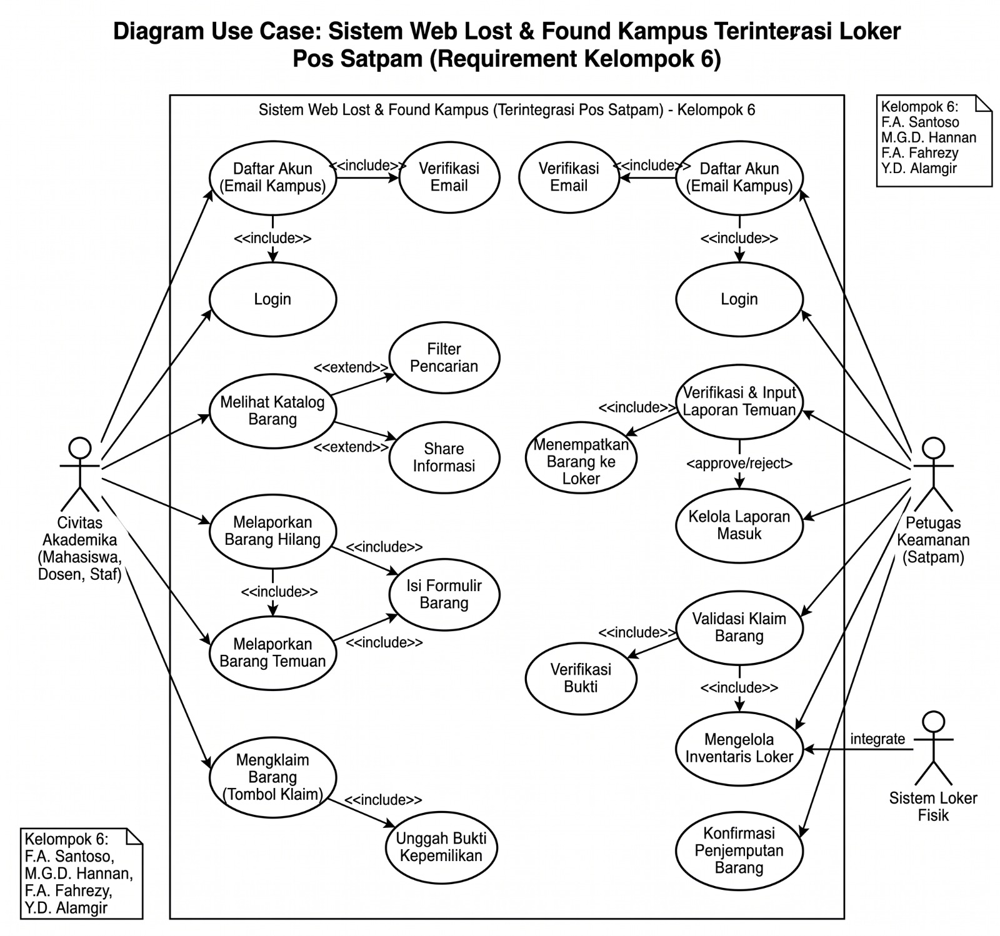
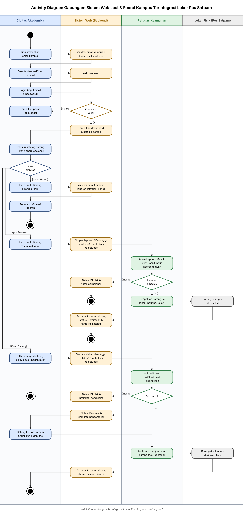
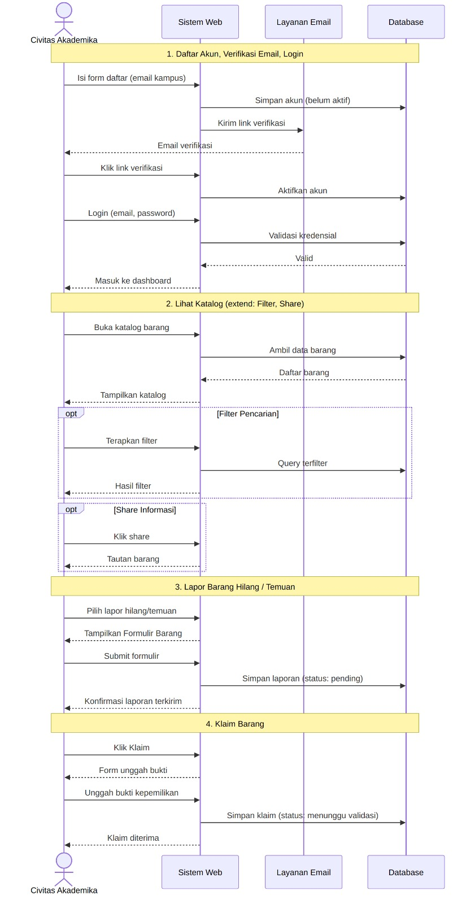
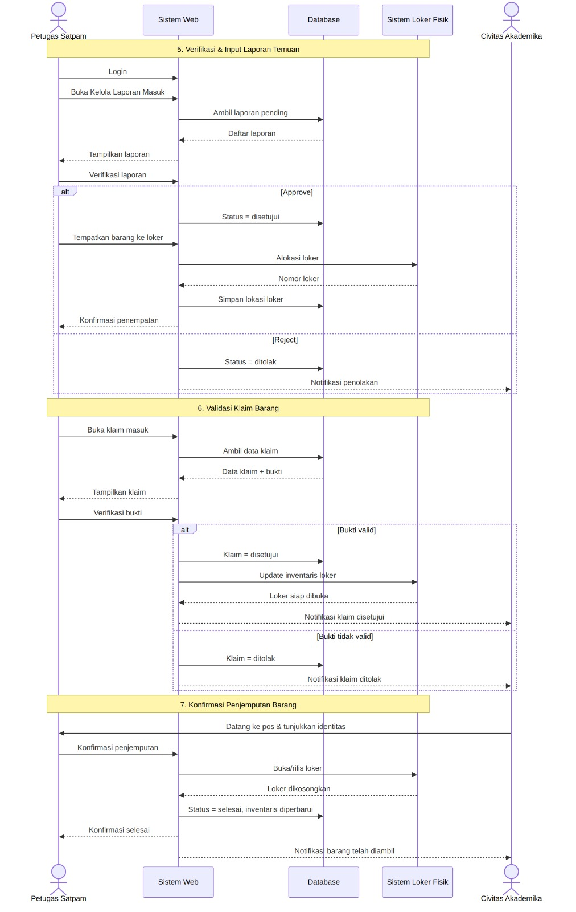
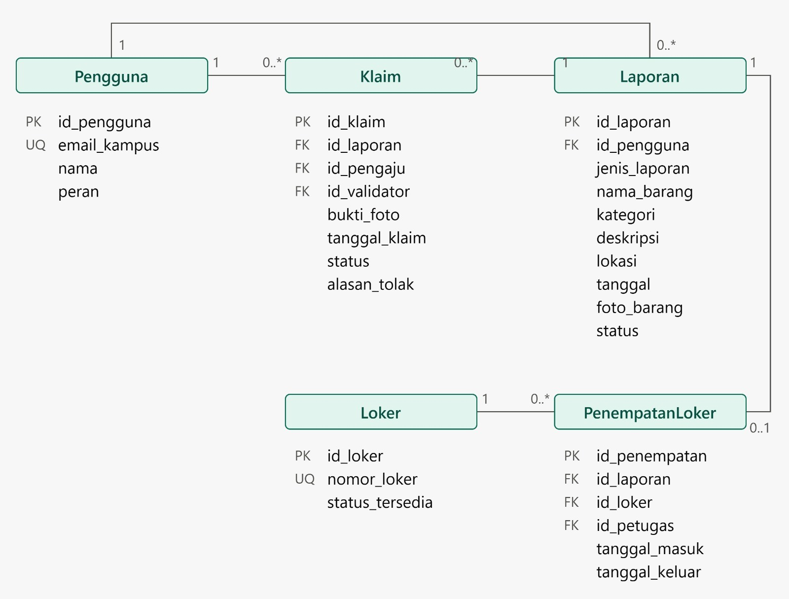

# Docs/Week 7 Design

**Mata Kuliah:** Rekayasa Perangkat Lunak  
**Kelompok:** 6  
**Kelas:** 3D  
**Anggota:**

1. 1251420135 Faiz Abyakta Santoso [Ketua]
2. 1251420098 Fandy Ahmad Fahrezy
3. 1251420089 Muhammad Ghassan Dzul Hannan
4. 1251420097 Yazid Dio Alamgir

---

## 1. Functional Requirements

Kebutuhan fungsional mendefinisikan apa saja yang harus bisa dilakukan oleh sistem.

- **FR-01 (Autentikasi)**  
  Sistem harus mengizinkan pengguna mendaftar dan login hanya menggunakan email berdomain kampus (misal: @mhs.kampus.ac.id).
- **FR-02 (Manajemen Laporan)**  
  Sistem harus menyediakan formulir bagi pengguna untuk melaporkan barang yang hilang atau barang yang ditemukan.
- **FR-03 (Katalog dan Pencarian)**  
  Sistem harus menampilkan daftar barang di beranda dan menyediakan fitur filter/pencarian berdasarkan nama barang, kategori, atau tanggal.
- **FR-04 (Pengajuan Klaim)**  
  Sistem harus mewajibkan mahasiswa mengunggah foto bukti kepemilikan ketika menekan tombol klaim pada suatu barang.
- **FR-05 (Validasi Klaim)**  
  Sistem harus memiliki dasbor khusus Satpam untuk melihat bukti foto yang diunggah mahasiswa, lalu menyetujui (Approve) atau menolak (Reject) klaim tersebut.
- **FR-06 (Manajemen Loker)**  
  Sistem harus memungkinkan Satpam memetakan barang temuan ke nomor loker fisik tertentu dan memperbarui status loker menjadi kosong jika barang sudah diambil.

---

## 2. Use Case Diagram

Diagram Use Case: Sistem Web Lost & Found Kampus Terintegrasi Loker Pos Satpam (Requirement Kelompok 6).

---

## 3. Activity Diagram

Activity Diagram Gabungan: Sistem Web Lost & Found Kampus Terintegrasi Loker Pos Satpam.

---

## 4. Sequence Diagram

**Bagian 1-4:** Daftar Akun & Login, Lihat Katalog, Lapor Barang, dan Klaim Barang.

**Bagian 5-7:** Verifikasi Laporan, Validasi Klaim, dan Konfirmasi Penjemputan.

---

## 5. Entity Relationship Diagram

Diagram relasi entitas untuk basis data sistem.

